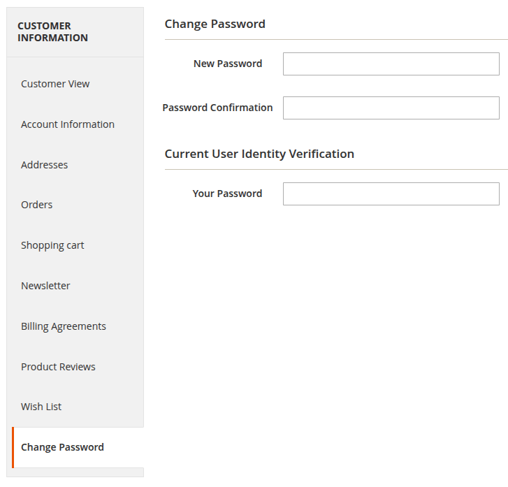

# YellowTeak_ChangeCustomerPassword module
Magento 2 module that makes it possible to change the customer password from the admin.  This can be useful for customer support purposes or when a customer has forgotten their password and needs assistance.

This module adds a new tab to the customer edit page in the Magento admin panel, allowing administrators to change the customer's password directly from there.

## Installation details
1. Run `composer require yellowteak/magento2-change-customer-password`
2. Run `php bin/magento module:enable YellowTeak_ChangeCustomerPassword`
3. Run `php bin/magento setup:upgrade`
4. In production mode, also run `php bin/magento setup:di:compile` and `php bin/magento setup:static-content:deploy`

## Configuration
Before the new tab will be visible in the customer edit page, you need to enable the module in the configuration settings. To do this, follow these steps:
1. Log in to the Magento admin panel.
2. Navigate to `Stores > Configuration > YellowTeak > Change Customer Password`.
3. Set `Enabled` to `Yes`.
4. Click `Save Config`.
5. Flush the cache by navigating to `System > Cache Management` and clicking `Flush Magento Cache`.

## Permissions
Changing a password requires its own permission. Administrators with access to all resources have it automatically. For roles with custom resource access, follow these steps:
1. Navigate to `System > Permissions > User Roles` and open the role.
2. On the `Role Resources` tab, select `Customers > All Customers > Actions > Change password`.
3. Click `Save Role`.

The `Change Password` tab is hidden for administrators without this permission.

## Usage
Once the module is enabled, you can change a customer's password by following these steps:
1. Log in to the Magento admin panel.
2. Navigate to `Customers > All Customers`.
3. Click on the customer whose password you want to change. The tab is not available while creating a new customer.
4. Click on the `Change Password` tab.
5. Enter the new password in the `New Password` and `Password Confirmation` field. The password has to meet the customer password rules configured under `Stores > Configuration > Customers > Customer Configuration > Password Options`.
6. For security reasons, you will also need to enter your own admin password in the `Your Password` field to confirm the change.
7. Click the `Change Password` button in the tab. The password is changed immediately, without saving the customer. Other unsaved changes on the customer page are left untouched.

After a successful change, the customer is signed out of all active sessions. If the customer account was locked because of failed login attempts, the lock is lifted. Entering a wrong admin password counts as a failed login attempt and can lock your admin account, the same as on the login page.

